> Das OpenSource Projekt "ELGA RefClient" zeigt eine Möglichkeit, wie man sich IHE-nativ mit den ELGA Schnittstellen verbindet und die CDA Generierung funktionieren kann. Das schweizer Opensource-Projekt "HUSKY" fungiert als Basis.

# Funktionen
- ELGA RefClient
  - API zum Erstellen von CDA-Dokumenten unter Verwendung der Husky API
  - Einfache REST-Inferfaces zur Kommunikation mit der Test-GUI
- Test-Oberfläche 
  - HTML5/Java-Script Oberfläche unter Verwendung des Polymer Frameworks
  - Kommuniziert mittels REST-Calls mit der in RefClient gekapselten API
    - Anmeldung mit O-Card
    - Kontaktbestätigungen erzeugen
    - Dokumente up/downloaden

# Basis & Erweiterungen
- Basis: HUSKY Health Usability Key (https://www.e-health-suisse.ch/technik-semantik/technische-interoperabilitaet/husky.html) 
  - https://github.com/project-husky/husky
  - Branch: feat/austrian_extensions
    - https://github.com/project-husky/husky/tree/feat/austrian_extensions)
- Österreichspezifische Erweiterungen folgender Pakete
  - husky-elga
  - husky-common-at
  - husky-communication-at
  
# Installationsanleitung
[[_TOC_]]

## Systemvoraussetzungen 
Beachten Sie, dass Sie nach jeder Installation einen Neustart durchführen!
Bevor Sie anfangen können, muss Ihr System folgende Voraussetzungen erfüllen:
1. **Java OpenJDK Version 17**
   
   Unter folgenden Link können Sie diese installieren: https://jdk.java.net/archive/
   
   Für Linux-User finden Sie hier eine Installationsanleitung für JAVA OpenJDK: https://openjdk.java.net/install/
2. **JAVA_HOME Environment Variable auf den Ordner OpenJDK 17 setzen**
3. **Git muss installiert sein**
   
   Unter folgendem Link finden Sie den Download für Git: https://git-scm.com/downloads
4. **Eclipse Version ab 2021-12 muss installiert sein**
   
   Unter folgendem Link verfügbar: https://www.eclipse.org/downloads/packages/installer 

### Setzen der JAVA_HOME Environment Variable
Die folgenden Screenshots wurden im Windows 10 erstellt. Geben Sie im Suchfeld ihres Computers Environment ein. Windows schlägt Ihnen dabei die Systemumgebungsvariable, falls Sie auf Deutsch arbeiten, vor. Bei Auswahl dieses Feldes öffnet sich ein Fenster mit den Systemeigenschaften (siehe Abbildung).

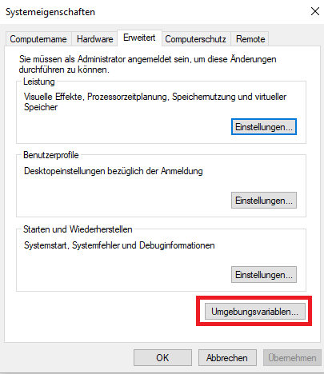

Hier können Sie überprüfen, ob die Variablen richtig gesetzt wurden. Klicken sie dabei auf Umgebungsvariablen. Es öffnet sich ein neues Fenster in denen Sie die Variablen überprüfen können. 

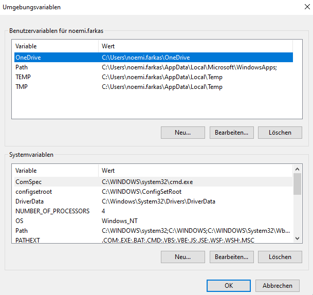

Falls Sie keine Variable JAVA_HOME anfinden, müssen Sie diese anlegen. Dafür klicken Sie entweder im Bereich Benutzervariablen oder Systemvariablen auf Neu…. Worauf sich erneut ein Fenster öffnet. 

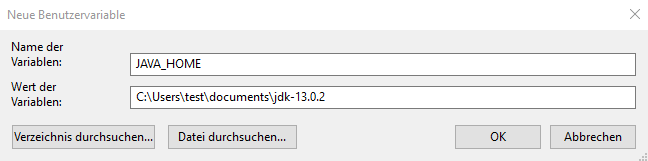

Bei der Vergabe des Namens der Variable geben Sie, JAVA_HOME ein (siehe Abbildung). Anschließend können Sie mittels dem Button Verzeichnis durchsuchen, den Pfad Ihrer entpackten Zip-Dateien angeben. Bestätigen Sie Ihre Eingaben mittels OK (mehrmals erforderlich).

### Installation von Eclipse
Unter: https://www.eclipse.org/downloads/packages/installer finden Sie neben dem Download auch eine Installationsanleitung. Folgen Sie dieser bis zum Punkt 3. Wenn Sie folgendes Fenster (siehe Abbildung) vor sich haben, wählen Sie Eclipse IDE for Enterprise Java Developers aus.

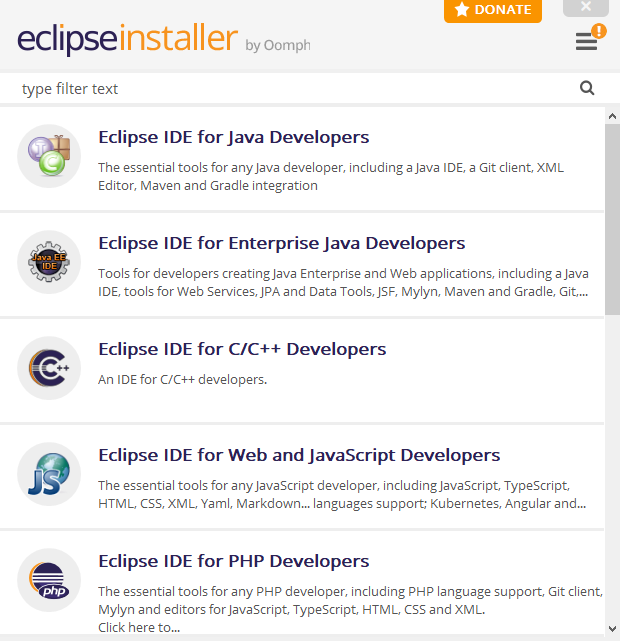

Befolgen Sie die weiteren Schritte der Installationsanleitung wie auf der Seite angeben.

## ELGA Referenzclient 
### Projekt herunterladen
1. Damit Sie mit GitLab eine Verbindung aufbauen können benötigen Sie einen SSH-Key. Erstellen Sie einen SSH-Key, falls Sie noch keinen zur Verfügung haben sollten. Unter dem Link https://gitlab.com/help/ssh/README#generating-a-new-ssh-key-pair finden Sie eine detaillierte Anleitung zum Erstellen von SSH-Keys.

   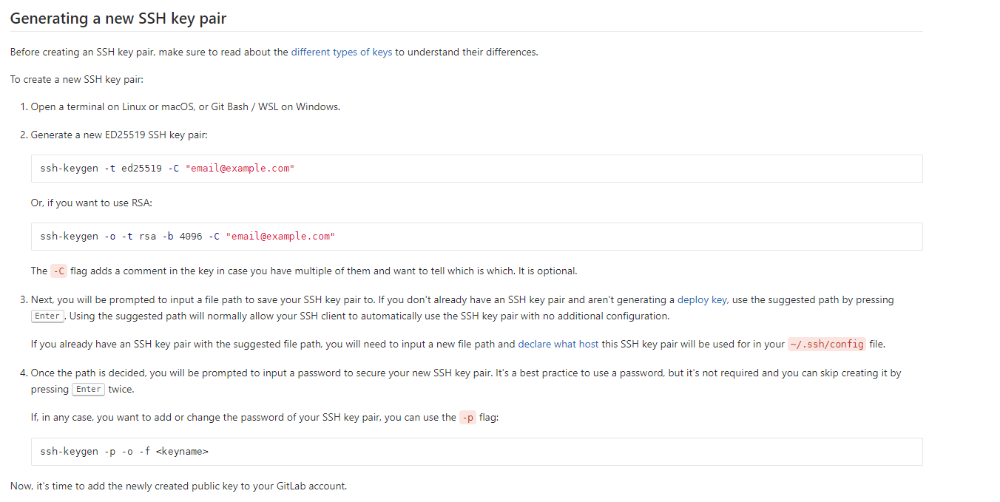

   Geben Sie in ihren Terminal (öffnen bei Windows durch Eingabe von cmd im Suchfeld) den Code zum Generieren ein (siehe Abbildung oben).
2. Sollten Sie schon über einen Key verfügen, finden Sie unter https://gitlab.com/help/ssh/README#review-existing-ssh-keys auch eine Anleitung zum hochladen. Achten Sie darauf einen öffentlichen SSH Key hochzuladen.

   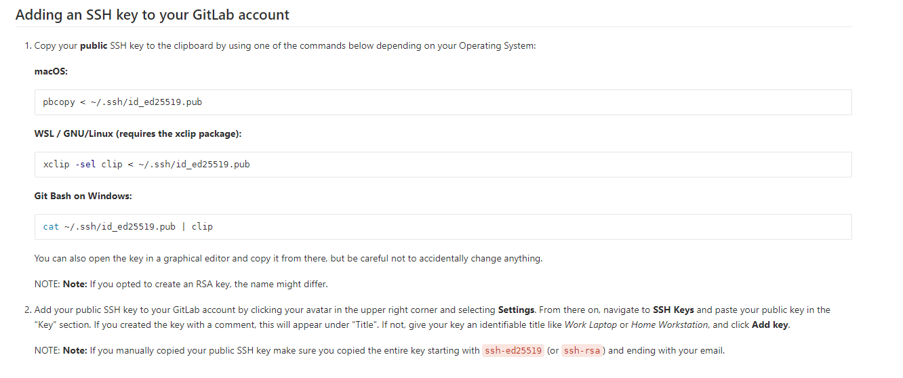
   
   Verfahren Sie gleich wie in Punkt 1 beschrieben, durch Eingabe des passenden Codes im Terminal. Sollte es zu Fehlermeldungen kommen bzw. der Key nicht gefunden werden, starten Sie Ihr System neu und versuchen Sie es erneut. Es kommt in vielen Fällen vor, dass besonders unter Windows nach jeder Installation einen Neustart benötigt, um die Funktion zu gewährleisten.
3. Öffnen Sie die Website https://gitlab.com/users/sign_in und loggen Sie sich mit Ihren Zugangsdaten ein.
4. Klicken Sie im rechten oberen Bildschirm Bereich auf das Icon (siehe Abbildung) und wählen Sie Settings aus
   
   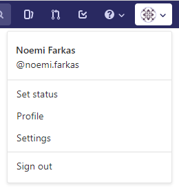

5. In der linken Bildschirmhälfte finden Sie den Menüpunkt SSH Keys. Wählen Sie diesen aus um einen SSH Key zu erstellen oder einen bereits existierenden Key hochzuladen.
   
   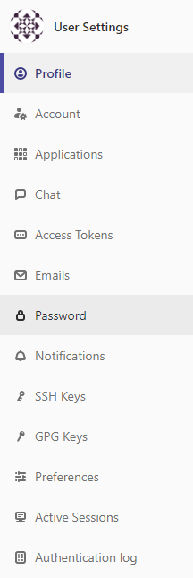

6. Hier können Sie den public-Key (Endung ".pub") eintragen. Öffnen Sie in ihrem Explorer dazu den Ordner in dem Sie den Key abgespeichert haben und geben Sie den Schlüssel ein. Der Text innerhalb dieser Datei beginnt mit "ssh-rsa" (kann einfach mit dem Notepad geöffnet werden). Ist dies nicht der Fall, dann ist diese Datei auch kein public-Key. 

   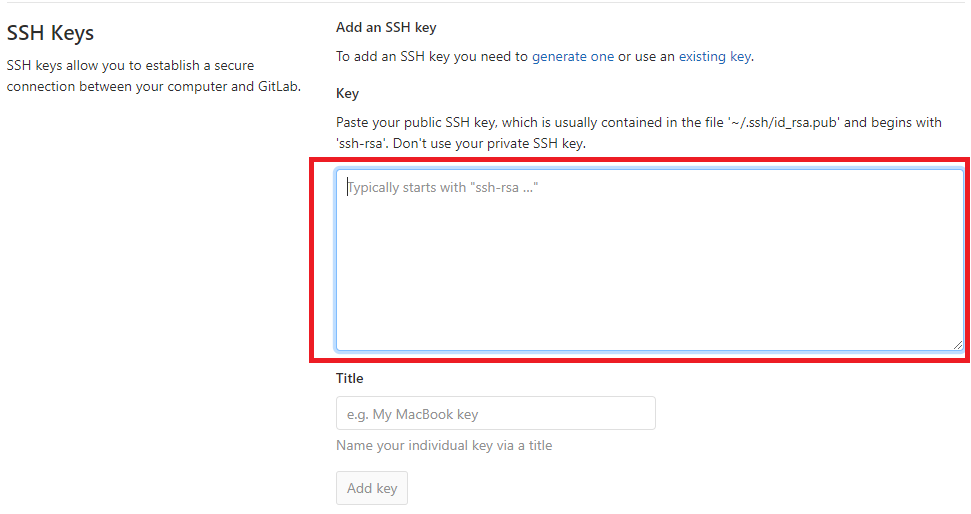

7. Geben Sie in ihrem Terminal nun folgendes ein: git@gitlab.com:elga-gmbh/refclient.git und führen Sie den Befehl aus.
8. Nun können Sie Eclipse öffnen

### ELGA Referenzclient im Eclipse öffnen 
1. Nach dem Öffnen von Eclipse wählen Sie in der Menüleiste File und Import…
2. Öffnen Sie den Ordner Maven und wählen Existing Maven Projects aus

   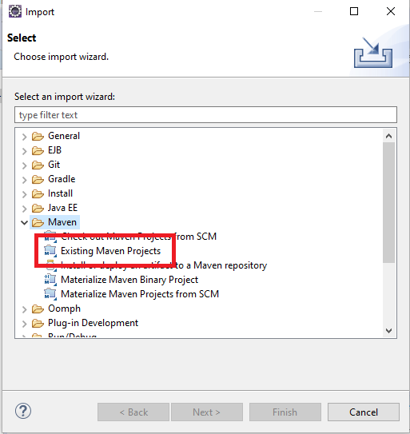

3. Wähle die root directory aus
4. Aktivieren Sie das Kästchen bei /pom.xml, damit alle Felder zu markieren oder klicken Sie auf Select All

   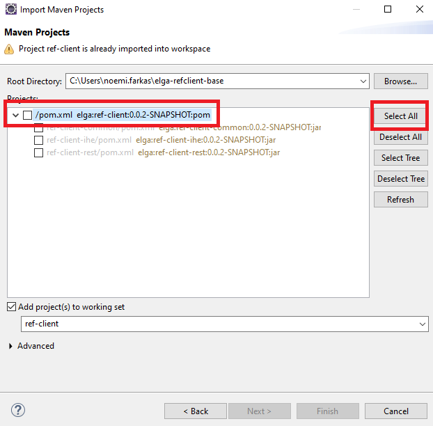

### ELGA Referenzclient builden
1. Klicken Sie mit der rechten Maustaste auf das Projekt ref-client und wählen Sie „Maven“ und „Update Project“ aus. Unter Windows können Sie stattdessen den Shortcut Alt F5 verwenden (siehe Abbildung). 

   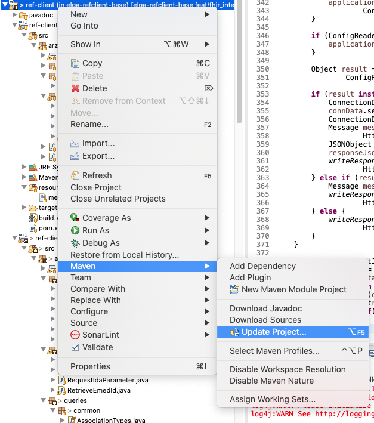

2. Als nächstes fügen Sie eine neue Maven Build Konfiguration hinzu. Klicken Sie wieder mit der rechten Maustaste auf den Projektordner und wählen Sie „Run as“ und „Run Configurations…“ aus (siehe Abbildung).

   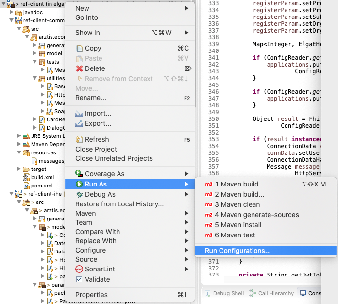

3. Im sich darauffolgenden Fenster, müssen Sie ihre Base directory einstellen, in dem Sie auf den Button Workspace klicken (siehe Abbildung).

   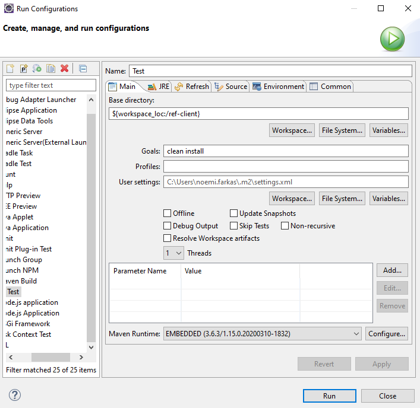

4. Wählen Sie im nächsten Fenster die gewünschte Directory aus und klicken Sie auf OK.

   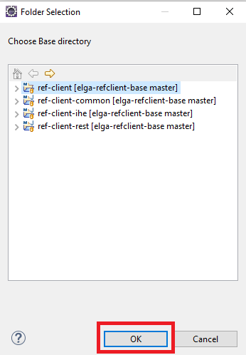

5. Achten Sie darauf, dass Sie im Feld Goals den Text „clean install“ enthaltet. Klicken Sie auf Apply und anschließend auf den Button Run.

### Keystore anlegen 
1. Erstellen Sie im ELGA Referenzclient Projekt einen Ordner keystore, wenn dieser Ordner noch nicht vorhanden ist
2. Gehen Sie in Ihrem Terminal zu dem Ordner wo Sie Java installiert haben (JAVA_HOME Umgebungsvariable) und gehen Sie in den Ordner „bin“
3. Erstellen Sie einen keystore mit dem Namen cacerts1_keystore.jks und einen keystore mit dem Namen cacerts1_truststore.jks
   1. Um einen Keystore zu erstellen schreiben Sie folgendes Kommando in das Terminal „keytool -genkey -alias <alias> -keystore <keystorename>.jks -storepass <storepassword> -keyalg <keyalg>“. Tauschen Sie alle <> Klammern mit Ihren persönlichen Werten aus.
   2. Wenn Sie Enter drücken müssen Sie folgende Angaben machen:
      1. Vor- und Nachname (Das muss der Servername sein z.B. localhost)
      1. Organisationseinheit
      1. Stadt oder Lokalität
      1. Staat oder Provinz
      1. Ländercode z.B. AT
   3. Kopieren Sie den generierten Keystore *.jks aus dem $JAVA_HOME/bin/ Ordner in den zuvor erstellten keystore Ordner.
4. (Nur wenn mit GINA und e-Card gearbeitet wird, wird dieser Punkt benötigt) Wenn Sie die benötigten Zertifikate bereits besitzen, springen Sie zum Unterpunkt 3. Ansonsten können Sie sich diese unter https://www.chipkarte.at/cdscontent/?contentid=10007.678619&portal=ecardportal herunterladen.
   1. Hier sind die Links zu den Zertifikaten die Sie benötigen:
      1. https://www.chipkarte.at/cdscontent/load?contentid=10008.551213&version=1391172959
      1. https://www.chipkarte.at/cdscontent/load?contentid=10008.551176&version=1391172955
      1. https://www.chipkarte.at/cdscontent/load?contentid=10008.632990&version=1472131007
      1. https://www.chipkarte.at/cdscontent/load?contentid=10008.632986&version=1472130988
   1. Weiters müssen Sie in der Konfigurationsdatei https://gitlab.com/elga-gmbh/refclient/-/blob/master/ref-client-rest/resources/config_elga_ref_client.properties folgende Endpunkte einstellen:
      1. TARGETENDPOINT_PDQ = /elga-proxy/1/zpi-ihe-ws
      1. TARGETENDPOINT_ELGAPLUS_ETS_IMPF = /elga-proxy/1/ETS
      1. TARGETENDPOINT_ELGAPLUS_EHEALTH_IMPF = /elga-proxy/1/EHEALTH/XCA/eHealth
      1. TARGETENDPOINT_ELGAPLUS_KBS_IMPF = /elga-proxy/1/KBS
      1. Sie müssen in der Konfigurationsdatei die HERSTELLER_ID mit Ihrer Hersteller ID ausfüllen, welche Sie für die Anmeldung bei der GINA benötigen. Außerdem müssen Sie die IP Adresse der GINA in der Konfigurationsdatei angeben.
   1. Importieren Sie die benötigten Zertifikate der SVC in den cacerts1_keystore und den cacerts1_truststore.
      1. keytool -importcert -file <cerfilepath>.cer -keystore <keystorename>.jks -alias <alias>
5. Importieren Sie den erhaltenen Key des jeweiligen ELGA Bereichs in den cacerts1_keystore mit privatem Schlüssel:
   1. openssl pkcs12 -export -in <pemfilepath>.pem -name test -out <name>.p12
   2. keytool -importkeystore -srckeystore <name>.p12 -srcstoretype pkcs12 -destkeystore <keystorename>.jks -deststoretype pkcs12
6. Importieren Sie den erhaltenen Key des jeweiligen ELGA Bereichs in den cacerts1_keystore ohne privaten Schlüssel:
   1. keytool -import -trustcacerts -alias name -file <pemfilepath>.pem -keystore <keystorename>.jks
7. Importieren Sie das erhaltene Zertifikat des jeweiligen ELGA Bereichs in den cacerts1_truststore:
   1. keytool -import -trustcacerts -alias name -file <pemfilepath>.pem -keystore <keystorename>.jks
   
### Passwort für Keystore bereitstellen 
1. Legen Sie eine Umgebungsvariable mit dem Namen ELGA_REF_CLIENT_PASSWORD an und vergeben Sie ein Passwort.
2. Laden Sie sich das Projekt https://github.com/jasypt/jasypt/releases/download/jasypt1.9.3/jasypt-1.9.3-dist.zip herunter und extrahieren Sie den Ordner.
3. Öffnen Sie ein Terminal und gehen Sie zum Ordner, wo Sie jasypt gespeichert haben.
4. Gehen Sie in den bin Ordner des jasypt Projekts.
5. Je nach Betriebssystem wählen Sie die Datei encrypt.sh (Linux/Unix) oder encrypt.bat (Windows) aus. Geben Sie folgenden Befehl in die Kommandozeile ein „encrypt.sh input="<keystorepasswort>" password=<Passwort> algorithm=PBEWithMD5AndDES“. Setzen Sie Ihr persönliches Passwort aus dem 1. Punkt anstelle des Platzhalters <Passwort> und anstelle des Platzhalters <keystorepasswort> das Keystore Passwort aus dem letzten Punkt.
6. Kopieren Sie den Text unter OUTPUT in die Startargumente des ELGA Referenzclients. 

### ELGA Referenzclient in Eclipse starten
1. Legen Sie eine „Run Configuration“ an. Klicken Sie wieder mit der rechten Maustaste auf den Projektordner und wählen Sie „Run as“ und „Run Configurations…“ aus (siehe Abbildung).

   

2. Setzen Sie das Project auf „ref-client-rest“ und fügen Sie die Main Klasse (arztis.econnector.rest.ElgaRefClient) zur „Run Configuration“ hinzu (siehe Abbildung)

   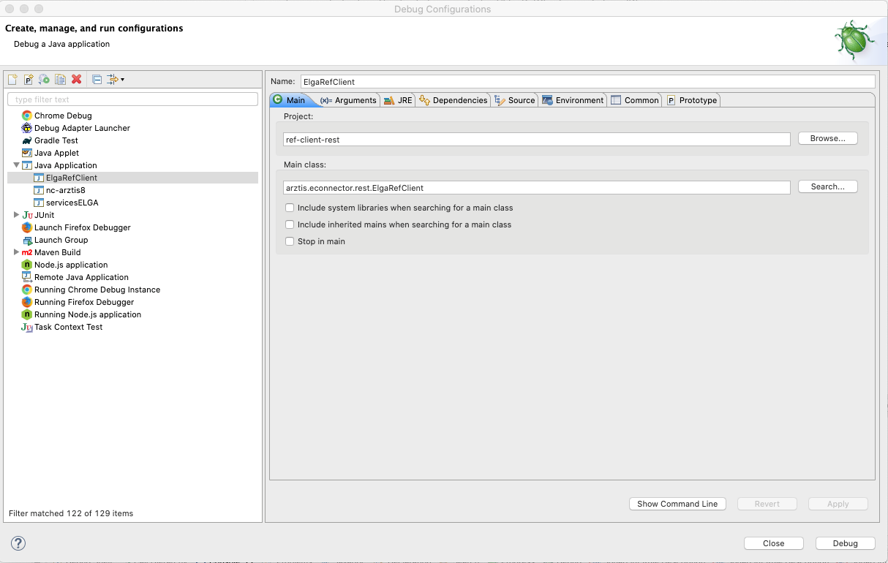

3. Als nächsten Schritt setzten Sie Ihr Keystore Passwort (welches Sie unter dem Punkt „Passwort für Keystore bereitstellen“ festgelegt haben) in die Programm Argumente (siehe Abbildung)

   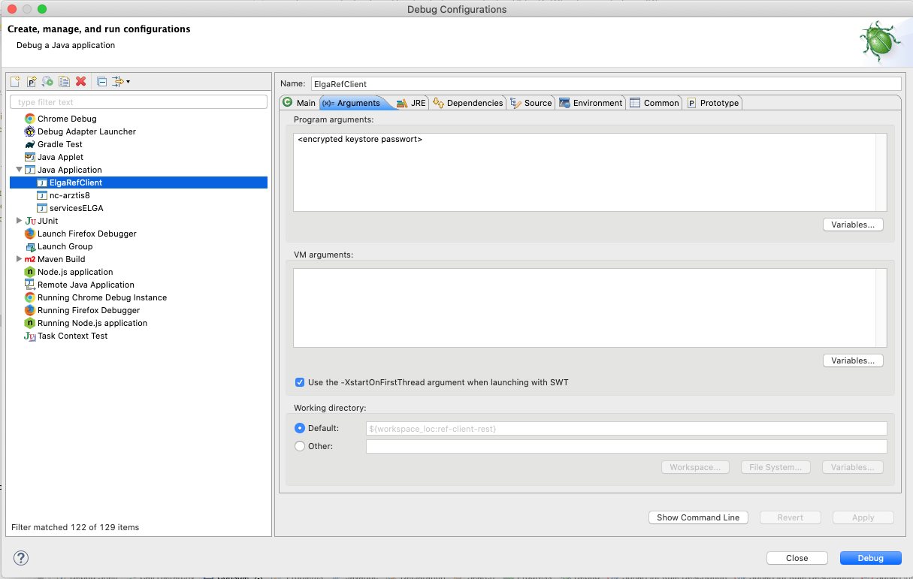

4. Klicken Sie auf Run, um den ELGA Referenzclient zu starten.

### ELGA Referenzclient Installation 
1. Legen Sie einen Ordner an mit folgenden Unterordnern:
   1. resources (diesen Unterordner können Sie aus dem Eclipse Projekt kopieren)
   2. keystore (dieser Unterordner wurde unter Punkt „Keystore anlegen“ beschrieben)
2. Speichern Sie die Datei ref-client-rest-1.0.0-SNAPSHOT.jar ebenfalls in diesen Ordner
3. Das Programm kann mit Hilfe des Befehls aus dem Punkt „ELGA Referenz Client aus der Kommandozeile starten“ gestartet werden.

### ELGA Referenzclient aus der Kommandozeile starten 
1. Öffnen Sie ein Terminal geben Sie folgenden Befehl ein:
   1. <JAVA_HOME>/bin/java -Dfile.encoding=UTF-8 -jar ref-client-rest-1.0.0-SNAPSHOT.jar <encrypted keystore password>. Ersezten Sie die Platzhalter <> mit Ihrem Wert
